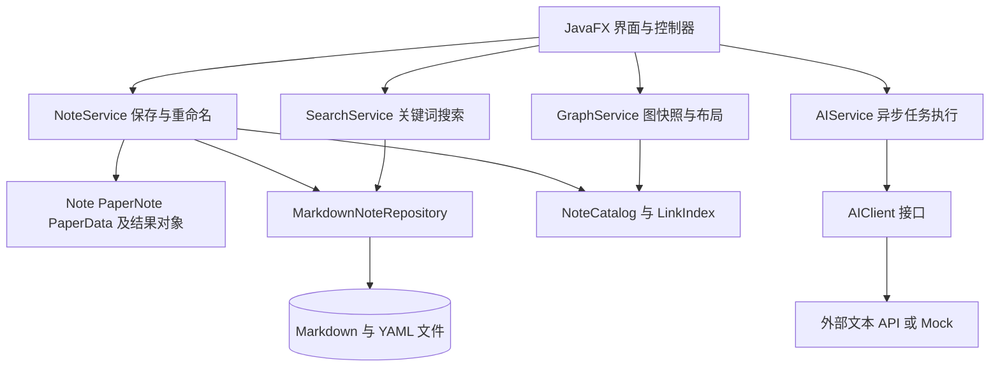
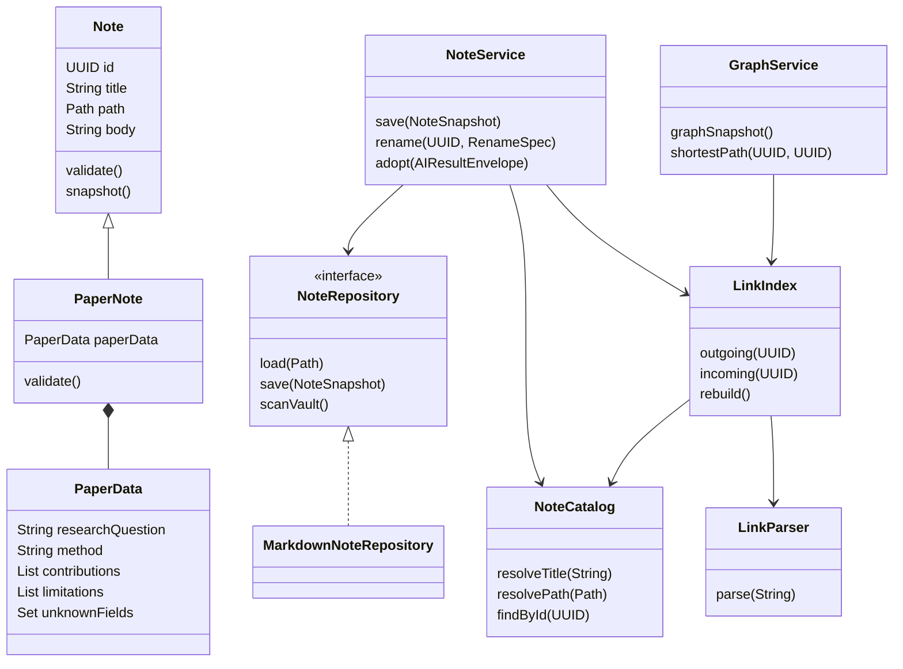
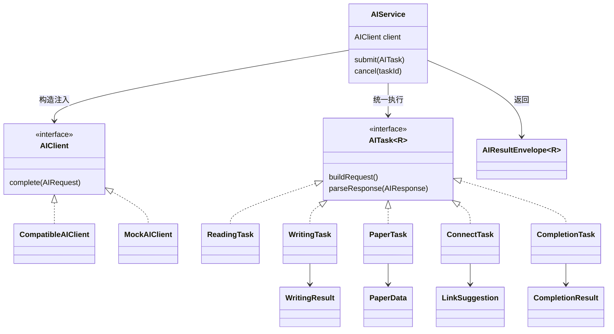
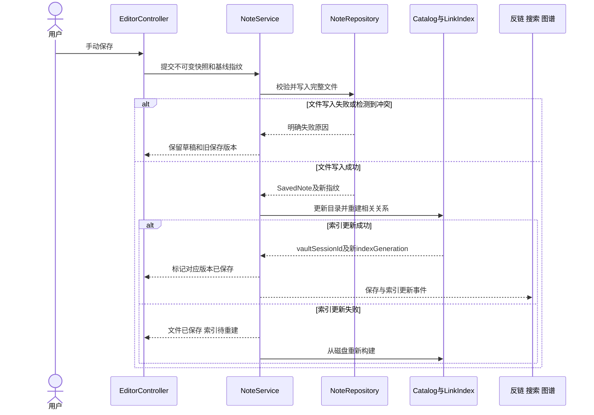
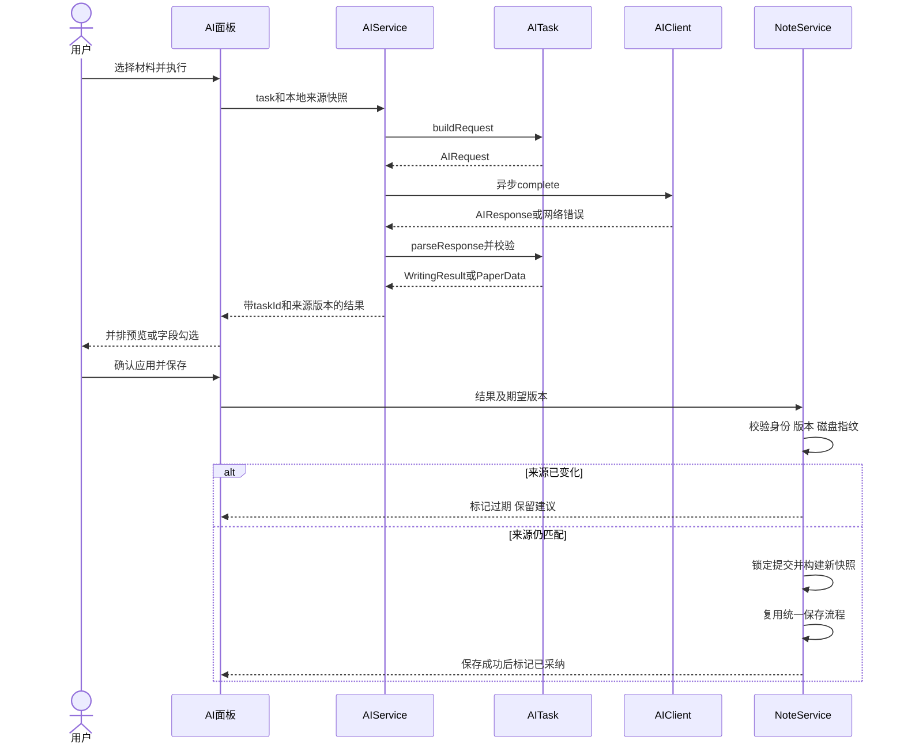
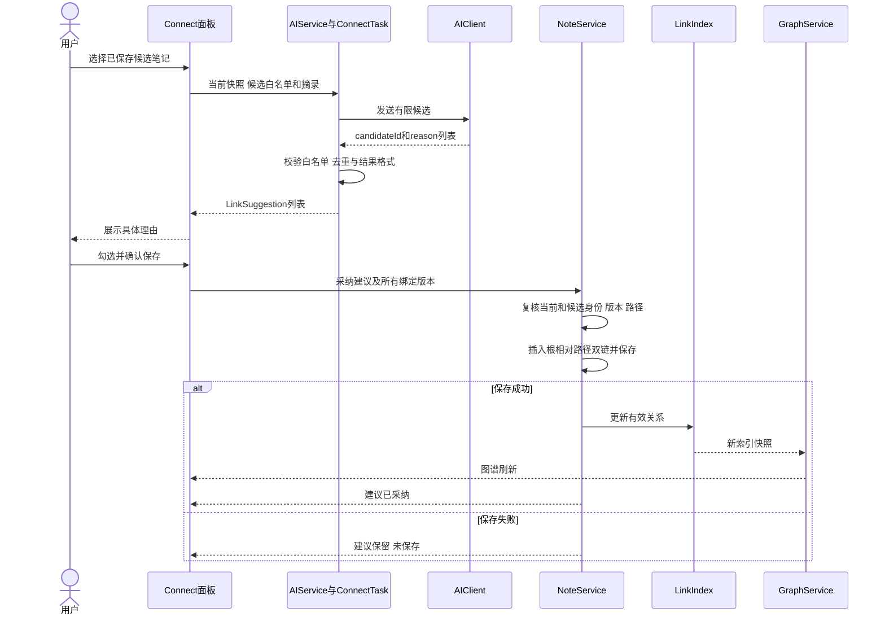

# LinkNote V1.2 项目开发计划书

版本 V1.2　　编制于 2026 年 11 月 25 日　　修订于 2026 年 11 月 27 日　　适用于课程项目开发与验收

LinkNote 是面向课程学习和论文阅读的 JavaFX 本地桌面笔记应用。用户以 Markdown 记录概念和论文，用双链组织关系，通过反链、图谱与关键词搜索回看知识，再按需调用外部文本模型完成阅读总结、写作整理、文献提取和关联建议。

本版确立后续开发的需求、数据、接口和验收基线。先跑通本地笔记和基础 AI，再完成中期反馈要求的跨电脑图片分享、Java 代码补全与 AI 公式补全。三项均为最终 P0，按第 14 节分阶段验收。其他增强按 P1 顺序安排。

团队按本基线认领任务并安排集成。范围发生变更时，记录原因、影响与新的验收条件。

## 1 基线结论与版本承接

### 1.1 已确定的开发决策

| 决策编号 | V1.2 基线 | 对开发的约束 |
|---|---|---|
| B01 | Java 21 与 JavaFX 21，本地 Windows 桌面应用 | 开发和发布环境统一，不增加服务端 |
| B02 | Markdown 正文加 YAML front matter 为唯一可信数据源 | 暂不使用 SQLite；索引和图数据均可重建 |
| B03 | 仅普通 Note 与 Paper 两种笔记类型 | 科研概念、实验记录等使用普通 Note，不新增类型 |
| B04 | 编辑、文件管理、双链、反链、图谱、搜索组成核心闭环 | 核心功能在断网和无 API Key 时仍可使用 |
| B05 | AI Reading、Writing、Paper、Connect 四类目标 | P0 先做总结和 Paper 提取，并交付编辑器的 AI 公式补全。其他操作按 P1 推进 |
| B06 | 智能关联是最高优先级 P1 | 按容量立项，采纳后写正文双链并通过保存更新图谱 |
| B07 | AI 统一客户端、泛型任务、结果对象与异步服务 | 网络传输与任务行为分开，客户端构造注入 |
| B08 | 笔记的持久化修改通过统一保存入口 | 文件保存成功后更新派生索引。复制附件和导出分享包分别通过文件服务完成 |
| B09 | 稳定 UUID 标识笔记，标题和路径可变 | 重命名不改变 ID，AI 返回不得越权修改其他笔记 |
| B10 | 三人按文件与编辑、双链与图谱、AI 与 Paper 分工 | S1–S2 由 C 集成，S3–S5 由 B 接手。新增交付由 A 负责图片、B 负责 Java 本地补全、C 负责 AI 公式补全 |
| B11 | 图片随单篇笔记分享 | 库内使用笔记相对路径。导出 ZIP 时同时打包正文和被引用的图片，在接收端离线验证 |
| B12 | 编辑器具备本地 Java 补全与 AI 公式补全 | 本地补全服务于 Java 代码块。AI 只在用户触发后发送公式附近的选定文本，确认后插入草稿 |

### 1.2 对前版方案的收敛

延续 V1.0/V1.1 的本地双链笔记、科研 Paper、图谱和 AI 辅助方向。本版吸收 V1.1 审查中的轻量闭环要求，并细化后续讨论中的四类 AI、对象协作、结果确认和关联联动。

关键调整如下：

1. P0 使用手动保存、单个活动编辑文档和 Markdown 预览。预览保留中期原型的行内与独立公式渲染，新增本地图片。自动保存、多标签页和图路径查询后置。
2. 知识库问答、RAG、Embedding、向量库和 Agent 移出本次范围。当前材料提问只处理用户指定的当前文本。
3. AI 的方法、贡献和局限提取与事实元数据分开处理；未知字段明确保留为未知。
4. Writing 采用原文与建议并排预览；Connect 返回候选 UUID 和理由，经校验与确认后写入双链。
5. 统一 LinkIndex 为关系来源；明确重命名、同名标题、失效链接、代码块和索引更新规则。
6. 以互斥模块预算估算代码量，共同网络、异步、界面与结果校验只计算一次。
7. 根据中期答辩反馈，把跨电脑图片分享、Java 代码补全和 AI 公式补全纳入最终 P0。

### 1.3 材料依据与尚待确认事项

产品范围沿用原对话确定的本地笔记、四类 AI 和面向对象设计，并纳入团队后续评审意见。

课程人数、截止时间、评分占比、分工权重和提交命名按团队对《2026面向对象大作业要求》第 3 页的核对结果登记。提交命名见第 21.3 节。中期答辩反馈见第 20.2 节的变更记录。

团队已确定为三人。启动时将 A、B、C 对应到实际成员并登记每周可投入时间，API 服务商和调用预算在真实小样本验证前确定。

## 2 项目目标与课程约束

### 2.1 目标用户与核心问题

目标用户是需要整理课程概念、阅读论文并建立知识联系的学生。应用解决三项连续任务：把材料保存为可长期编辑的文件，把笔记之间的关系显式表达出来，把 AI 结果转化为经过用户确认的笔记内容。

典型使用过程为：新建“矩阵分块”普通笔记，记录原理并链接到“缓存局部性”；新建 Paper，粘贴论文摘要，提取研究问题、方法与贡献；选择这两篇笔记作为关联候选，查看 AI 给出的理由，确认后建立链接并在图谱中看到新边。

### 2.2 课程约束

| 项目 | 当前登记内容 | 执行安排 |
|---|---|---|
| 团队规模 | 课程允许 3 至 4 人，本组为 3 人 | 按第 13 节认领三项职责 |
| 截止时间 | 2026年12月27日 23:59:59，北京时间 | 12月26日形成候选提交包，27日保留复核与上传时间 |
| 有效 Java 行数参考 | 本组三人约 2000 至 3000 行 | 开发后按课程原文口径实测 |
| 展示占比 | 40% | 保证真实演示、稳定启动和完整用户路径 |
| 代码占比 | 30% | 体现封装、接口、多态、集合、异常与对象协作 |
| 文档占比 | 20% | 需求、设计、测试、使用和分工材料同步维护 |
| 中期占比 | 10% | 归档已展示的中期原型、进度记录和老师反馈 |
| 分工权重 | 0.9至1.1 | 保留任务与贡献证据，按课程口径填写 |
| 提交命名 | 外层 ZIP、全部代码、开发文档、用户说明书、展示 PPT | 按第 21.3 节的课程命名模板复核 |

### 2.3 完成标准

P0 完成要求：Windows 脱离 IDE 启动；创建、编辑、手动保存、关闭重开笔记；双链跳转和反链一致；重命名后引用可用；图谱仅展示有效关系；关键词搜索可定位笔记；Paper 模板可保存；真实 API 可以完成总结和结构化提取；Mock 能覆盖离线和异常演示；失败时原文与已保存文件保持可恢复。

最终 P0 还须完成三条路径。接收者在另一台电脑解压分享包后能离线看到图片。在 Java 代码块中能用键盘选择关键词、模板与当前块变量名。使用真实 API 取得公式补全建议，预览、确认插入并手动保存，重开后仍可渲染。对应验收见 T39 至 T45。

基础闭环和三项新增 P0 都通过后，再按容量依次考虑手动候选 Connect、Writing 并排确认、Reading 增量。最终报告的进度状态与实际演示一致。

## 3 需求范围与优先级

### 3.1 P0 必交闭环

| 需求编号 | 功能 | 最小实现与验收结果 |
|---|---|---|
| N01 | 笔记库与文件管理 | 选择本地目录、浏览目录树、新建文件夹和两类笔记、打开文件。按第 5.5 节过滤扫描，删除笔记时确认并保留恢复副本 |
| N02 | Markdown 编辑 | 普通文本编辑器、脏状态提示、手动保存、切换或退出时提示处理未保存内容 |
| N03 | Markdown 预览 | 标题、段落、列表、代码块、表格和常用链接可读，双链可跳转。沿用中期原型的 `$...$` 行内公式、`$$...$$` 独立公式和随包公式资源 |
| N04 | 双链解析与跳转 | 标题唯一时支持标题链接，同名使用根相对路径；代码区不解析 |
| N05 | 反向链接 | 由有效已保存关系推导，点击来源可以打开笔记 |
| N06 | 重命名 | 更新目标名称和有效引用，逐文件校验指纹、备份、按状态恢复并重建索引 |
| N07 | 基础图谱 | 展示有效节点与边，区分 Note/Paper，支持跳转、拖拽、缩放及重新布局。超限提示并丢弃过期布局结果 |
| N08 | 关键词搜索 | 搜索已保存标题和正文，返回标题、路径、摘要片段，点击打开 |
| N12 | 本地图片与单篇笔记分享 | 导入 PNG/JPEG 并预览，将笔记与实际引用图片导出为 ZIP。在另一台电脑解压后，离线打开能看到正确图片 |
| N13 | Java 代码补全 | 标记为 Java 的 Markdown 围栏代码块内提供关键词、常用模板和当前块光标前已声明的局部变量名。候选可键盘选择、插入或关闭 |
| P01 | Paper 基础模板 | 基础元数据和科研字段能编辑、保存、重开，未知值可表达 |
| A01 | AI 基础设施 | BYOK 配置、统一异步执行、超时与错误提示、取消、Mock 和发送范围提示 |
| A02 | Reading 总结 | 选择当前文本或当前笔记正文，返回总结，只展示后由用户决定保存 |
| A03 | Paper 提取 | 用户粘贴摘要或文本，返回结构化科研字段，逐项审核后保存。AI 来源由应用标为未核验 |
| A09 | AI 公式补全 | 真实 API 按用户确认的局部上下文返回 LaTeX 建议。支持渲染预览、版本校验和确认插入草稿，经手动保存后重开验证 |
| Q01 | 发布与恢复 | Windows app-image 启动、文件失败与索引异常提示、重开和重建索引可验收 |

### 3.2 P1 增强顺序

| 顺序 | 需求编号 | 功能 | 交付范围与进入条件 |
|---|---|---|---|
| 1 | A04 | Connect 手动候选关联 | 最高优先 P1；有效 ID、理由、用户确认、保存与图谱更新闭环，依赖 N04至N07、A01 |
| 2 | A05 | Writing 整理 | 全文或选区整理，并排预览，版本校验后确认保存；依赖 N02、A01 |
| 3 | A06 | Reading 增量 | 翻译、解释、当前材料提问，共用 ReadingTask 的操作参数 |
| 4 | A07 | Writing 增量 | 润色和提纲，共用 WritingTask，不为每个提示词新增类 |
| 5 | N09 | 多标签页 | 每个标签独立脏状态和版本 |
| 6 | N10 | 自动保存 | 在手动保存和冲突检测稳定后接入同一保存入口，不能绕开版本检查 |
| 7 | N11 | 图路径与筛选 | BFS 无向最短路径、邻居或类型筛选，保持底层关系方向 |
| 8 | A08 | 候选范围扩展 | 当前文件夹或关键词 Top-K；基于已有搜索结果，仍需用户确认候选范围 |
| 9 | P02 | 选定文献比较 | 用户选择2至3篇 Paper，比较指定字段，展示来源 ID 和未知项 |
| 10 | N14 | Java 成员补全 | 在可靠得知接收者类型时提示常见成员，依赖 N13 |
| 11 | A10 | AI Java 代码续写 | 在 Java 代码块由用户主动请求，预览并确认插入少量代码，依赖 N13、A09 的补全交互 |

为所有 P0 留足工时并通过第 14 节对应验收后，团队按剩余容量确定 P1。A04 手动候选 Connect 优先。P1 经阶段门确认后才纳入本期验收。最终发布以全部 P0 和目标机验收通过为条件。

### 3.3 P2 与明确排除项

白板列为 P2，课程交付前不排期。流式输出、复杂差异高亮、自动文献检索等没有默认交付承诺，需要重新评估后登记。

本次范围明确排除：全知识库问答、RAG、Embedding、向量数据库、Agent、云同步、用户登录、完整 PDF 阅读器。论文材料通过用户粘贴文本或摘要进入；本版不排期 PDF 导入与 PDF 文本抽取。外部服务依赖限于兼容 Chat Completions 的文本 API，不增加文献数据库 API。

## 4 用户界面与交互约定

### 4.1 主窗口

主窗口采用左侧目录与搜索、中间编辑与预览、右侧反链与 AI 面板。图谱使用独立页面或中心区域切换，P0 同时只编辑一篇笔记。标题栏或编辑页签显示当前标题、保存状态和错误状态。

```text
┌──────────────────────────────────────────────────────────────┐
│ LinkNote   笔记库   新建   保存   图谱   AI设置               │
├──────────────┬───────────────────────────┬────────────────────┤
│ 关键词搜索   │ 当前笔记标题   已保存/未保存│ 反链 / AI          │
│ 目录树       │ Markdown 编辑             │ 任务与发送范围     │
│ notes        │                           │ 执行状态和结果     │
│ papers       │ Markdown 预览             │ 确认 / 保留原文    │
└──────────────┴───────────────────────────┴────────────────────┘
```

编辑器先使用 JavaFX TextArea；预览使用 WebView 展示本地生成的 HTML。预览转义或禁用笔记中的原始 HTML。公式由应用随包的渲染资源处理，预览仅执行应用提供的公式脚本。外部链接经用户操作打开，远程图片默认不自动加载。本地图片通过第 5.7 节的路径校验后才加载。Markdown 解析器提供语法及源码范围，双链解析与保存规则由项目实现。

### 4.2 保存与切换

手动保存是 P0 的唯一常规提交动作。未保存正文可在编辑区预览，但反链、全局图谱与关键词搜索以最后成功保存的内容为准，界面明确提示“未保存的修改尚未进入图谱”。切换笔记、关闭窗口或切换笔记库时提供保存、放弃修改、取消三个选择。

AI 的“采纳并保存”会显式执行统一保存流程；保存失败时保留编辑内容和建议，状态显示“未保存”，不能显示“已采纳”。不自动把返回结果写回文件。

### 4.3 文件操作

新建使用模板生成 UUID 和必需字段。单篇删除先列出引用影响，经确认后将文件移入 `.linknote/recovery/`，相关入链转为失效提示。恢复目录按第 5.5 节的统一扫描规则排除。P0 不做递归删除非空目录。

普通正文编辑不直接修改 UUID。Paper 元数据由表单或受约束的 front matter 编辑入口修改。批量移动、文件夹级重命名与多窗口同时写同一笔记库不属于 P0。

### 4.4 图片与编辑器补全

- 编辑器提供「插入图片」和「导出单篇分享包」。图片文件就绪后，编辑器在光标处插入引用并更新预览。分享包使用已保存笔记，若有草稿先走第 4.2 节的保存或取消流程。
- 在标记为 `java` 的围栏代码块内，键入有效前缀后在编辑位置附近提示候选。最小候选包括 `ret` → `return`、`sout` → 打印语句、`fori` → 计数循环，以及当前块光标前声明的简单局部变量。用方向键选择，Tab 接受，Esc 关闭。候选可见时只替换当前前缀，保留后续正文。离开代码块或改变目标范围时关闭候选。无网络或 Key 时仍可用。
- 用户在当前公式中主动点击「AI 补全」，先核对将发送的文本，再预览建议的 LaTeX 源文及渲染效果。确认后更新当前草稿，仍通过手动保存提交。切换笔记、编辑或移动目标位置后，旧结果按第 8.6 节处理。

## 5 数据模型与文件格式

### 5.1 笔记库结构

```text
vault/
  notes/
    cache_locality.md
    matrix_blocking.md
  papers/
    sample_paper.md
  assets/
  .linknote/
    recovery/
    rename_operations/
```

普通 Note 与 Paper 的正文、元数据和图片引用均以 `.md` 为准，图片文件存入库内 `assets/`。`.linknote` 只保存恢复资料和操作记录，不保存第二份权威笔记或关系表。索引首先采用内存结构；缓存若后续持久化，必须能够删除并从 Markdown 重建。API Key 不放入笔记库。

### 5.2 普通 Note 示例

```markdown
---
schema_version: 1
id: "5adbfc29-18d1-41aa-b62a-3a4bc0ee7df5"
type: note
title: "矩阵分块"
created_at: "2026-11-25T14:00:00+08:00"
updated_at: "2026-11-25T14:00:00+08:00"
tags: ["architecture", "optimization"]
---

# 矩阵分块

将矩阵运算拆成子块，可以改善数据复用。
相关概念见 [[缓存局部性]]。
```

`title` 是导航和标题链接的权威标题，正文一级标题是可编辑内容，不参与身份判断。新建时同步初始化二者，之后正文标题变化不自动触发文件重命名。

### 5.3 Paper 示例

以下为格式示例，不代表真实论文信息。

```markdown
---
schema_version: 1
id: "d40f14ad-1d9c-40ef-a786-0baa09a52c38"
type: paper
title: "示例论文"
created_at: "2026-11-25T14:10:00+08:00"
updated_at: "2026-11-25T14:10:00+08:00"
tags: ["reading"]
paper:
  authors: []
  year: null
  venue: null
  doi: null
  url: null
  research_question: null
  method: null
  contributions: []
  limitations: []
  evidence_scope: "abstract"
  unknown_fields: ["authors", "year", "venue", "doi", "limitations"]
  sources: []
---

# 示例论文

## 阅读材料

在此粘贴摘要或正文摘录。

## 阅读笔记

在此记录个人理解与问题。

## 关联笔记
```

Paper 的结构化科研字段以 `paper` 映射为准，右侧表单从这些字段读取；正文负责材料、个人笔记和双链。AI 不同时维护一套同义正文摘要，避免两处字段逐渐分歧。用户可以自行在正文引用或扩写结构化结果。

### 5.4 字段约束

| 字段 | 规则 |
|---|---|
| schema_version | 当前为1；读取更高且不支持的版本时阻止覆盖并提示 |
| id | UUID，创建后稳定；标题、路径和类型展示变化不改变 ID |
| type | 仅 `note` 或 `paper` |
| title | 非空字符串；标题重复可保存，但短标题引用将出现歧义 |
| created_at / updated_at | 带时区的 ISO 8601；创建时间不变，更新时间随成功保存更新 |
| tags | 字符串列表，P0 只支持存储和基础编辑，不要求标签管理中心 |
| authors / contributions / limitations | 列表；未知用空列表加 unknown_fields，不把空列表解释成确认不存在 |
| year / venue / doi / url | 未知为 null；有值不等于经过外部核实 |
| evidence_scope | 记录 abstract、excerpt 或 full_text 等用户输入范围，摘要提取不冒充全文结论 |
| sources | 字段来源记录，含字段名、来源类别、来源定位及核验状态 |
| unknown_fields | 明确尚未取得依据的字段；界面显示“未知”或“材料未说明” |

`sources` 可记录 `field`、`kind`、`locator`、`verified`。材料定位可用段落号与短摘录，人工核验来源可用出版页或 DOI 页面链接。应用将 AI 提取的来源状态初始化为 `verified: false`。只有用户查看来源后明确执行“标记已核验”，才将当前字段的来源状态改为 `true`。字段值或来源变更后重新标为未核验。

### 5.5 文件读取与外部修改

所有文件按 UTF-8 读取和写入，文本换行在首次统一保存时规范化。YAML 解析只允许普通数据结构，限制输入规模与别名展开，不启用任意对象构造。保留未知 front matter 字段的值；不承诺逐字保留 YAML 注释和排版。

**统一扫描规则。** 笔记库扫描入口跳过根目录下的 `.linknote/` 和 `assets/` 子树，以及应用保存、重命名过程中生成的临时文件。图片由附件服务按引用读取。临时文件采用保留的 `.linknote-*.tmp` 命名。目录树的笔记项、关键词搜索、关系解析和 AI 候选枚举都使用这份过滤后的 `NoteCatalog`。恢复流程单独读取操作记录和备份，备份中的 UUID 不参与正常笔记的重复检查。

无 front matter 的外部 Markdown 先展示导入预检，用户确认后补齐 ID 等字段再保存。缺失或非法必需字段、重复 UUID、损坏 YAML 都显示具体文件和错误；异常文件不进入有效节点和关系索引，原文件保留。重复 ID 必须由用户确定哪个文件保留身份，不能静默给现有笔记换 ID。

P0 采用打开笔记库或手动刷新时扫描、保存前比较磁盘指纹的方案。若磁盘内容与加载基线不同，停止覆盖，让用户重新加载或另存副本。持续文件监听列为后续增强。P0 按单个应用实例编辑同一库设计；指纹检查不构成多进程并发事务。

### 5.6 内存对象与版本

`Note` 封装 ID、标题、路径、正文和通用元数据；普通 Note 直接使用 Note，`PaperNote extends Note` 增加 `PaperData`，对应 `type: paper`。类型差异用于模板、字段验证和编辑表单，不再增加无行为差异的子类。

`NoteSnapshot` 是任务发起时的不可变快照，包含 vaultId、noteId、会话内单调递增的 editRevision、bodyHash、metadataHash、diskFingerprint，以及选区范围和选区文本哈希。editRevision 每次编辑都递增，避免原文改后又恢复时被误认为同一次编辑。重启后不复用旧任务状态。

保存返回 `SavedNote`，包含本次成功写入的快照与文件指纹。编辑器若在保存期间继续发生修改，只能把已写入的那个版本标为已保存，较新的缓冲区仍保持未保存状态。最小实现可在短暂提交阶段锁定当前文档编辑。

### 5.7 本地图片与分享包

1. **导入。** 从本机选择 PNG 或 JPEG，校验能读取且在约定的大小上限内，复制到库的 `assets/`。采用唯一文件名并以无覆盖方式写入，原文件名或用户输入可作为替代文字。复制成功后插入标准 Markdown 引用，例如 ``。路径从当前笔记所在目录计算并统一使用斜杠。导入失败时保留草稿并清理本次临时文件。
2. **渲染。** 从当前笔记目录解析相对路径并校验最终文件在库内 `assets/`，包括解析符号链接后的真实位置。找不到文件时显示替代文字和失效路径。遇到来自别台电脑的绝对路径时，提示用户重新选择图片并用新的相对引用替换。只处理解析器识别的本地 Markdown 图片节点，代码示例原样保留。
3. **导出。** 从已保存的单篇 Markdown 收集实际引用的本地图片，将 Markdown 副本与该批图片写入 ZIP。包内采用同一层的 `note.md` 与 `assets/`，仅将副本中对应的图片地址改写为 `assets/<文件名>`。多次引用同一文件只打包一次，原笔记和库内图片保持原样。发现缺图或地址越界时列出具体项，保留已有导出文件，用户修正后重试。
4. **接收。** 接收者用系统工具解压 ZIP，在任意目录打开包里的 `note.md`。分享包的承诺范围是单篇笔记和其图片，其他笔记的双链仍由接收者自己的笔记库解析。验收时断网并使用另一台没有源笔记库的 Windows 电脑。

## 6 双链与关系一致性

### 6.1 链接语法与解析次序

P0 支持 `[[标题]]` 和 `[[根相对路径]]`。根相对路径以笔记库为根，使用 `/`，省略 `.md`，例如 `[[papers/sample_paper]]`。有 `/` 的目标按路径处理；无 `/` 的目标按标题处理。根目录文件如需路径消歧，写成 `[[./sample_paper]]`。

解析规则如下：

1. 从 Markdown AST 中提取正文普通文本区域的双链；跳过 front matter、围栏和缩进代码块、行内代码、转义标记和 HTML 区域。
2. 标题匹配使用去掉目标首尾空白后的精确标题。候选恰好一个才解析成功；零个为失效链接，多个为歧义链接。
3. 路径规范化后必须留在笔记库根目录内，并且指向 `NoteCatalog` 中登记的有效笔记。不允许绝对路径和越界 `..`。Windows 文件名碰撞按实际文件系统规则预检，包括大小写差异。
4. 不把 `[[不存在的标题]]` 自动建成真实节点。界面可显示失效标记，图谱只纳入成功解析的边。
5. 别名、标题锚点、块引用和嵌入语法不进入 P0；遇到未支持语法显示未解析提示，不猜测目标。

目录中可以存在同名标题。例如 `notes/cache.md` 与 `papers/cache.md` 均以“Cache”为标题时，`[[Cache]]` 必须提示歧义，改为路径链接才能确定。自动插入链接统一采用根相对路径，避免标题随后重名造成歧义。

### 6.2 有向边与反向链接

A 正文出现 B 的有效链接，形成 A→B。“双链”表示用户既能看到出链，也能查询反链，不要求自动在 B 正文写入 A。

同一源笔记多次引用同一目标只形成一条 `(sourceId, targetId)` 关系边，可以附带多处源码位置供定位。A→B 与 B→A 分别保留；布局可合并视觉线段，但不能丢掉底层方向。自链接允许解析与跳转，基础图谱可隐藏自环，邻居与 BFS 不重复处理自身。

### 6.3 LinkIndex 的唯一职责

`LinkIndex` 保存成功解析的有向出入邻接集合及未解析引用诊断，是所有关系查询的唯一来源。反链面板、GraphService、路径查询和关联去重都读取它。图谱不重新解析正文，不独立维护第二套可写关系。

`NoteCatalog` 管理 ID、标题和路径映射；搜索缓存只管理搜索文本，不承载关系。删除、重命名、添加同名标题或修复目标都可能改变其他文件的引用解析结果，因此目录身份映射变化时重算受影响引用；P0 可直接全量重建 LinkIndex，优先保证正确性。

### 6.4 保存与索引提交

保存顺序固定为：验证笔记和基线指纹 → 生成完整文件内容 → 写同目录临时文件 → 完成文件替换 → 记录成功快照 → 更新目录与关系索引 → 更新搜索缓存 → 发出保存或索引事件 → 刷新界面。

单文件优先尝试文件系统支持的原子移动；不支持时使用经过明确处理的替换方案并保留恢复能力。Java 文件移动的原子性受文件系统与选项支持限制，不据此承诺跨文件事务。[Java 21 Files 文档](https://docs.oracle.com/en/java/javase/21/docs/api/java.base/java/nio/file/Files.html)

文件写入失败时，旧索引与旧保存状态不变。文件已写成功但索引更新失败时，界面分别显示“文件已保存”和“索引待重建”，禁用基于旧索引的修改操作，触发从磁盘重建；不能把文件成功保存误报为失败，也不能继续把旧图谱当成最新状态。

### 6.5 重命名流程

P0 的“重命名笔记”同时修改 front matter 标题和文件名，UUID 保持不变。文件名采用可用的短 ASCII 名称，界面标题可用中文；标题和文件名分开输入。文件夹迁移另列增强。

执行分为以下步骤：

1. 刷新磁盘笔记快照，保证影响分析使用与磁盘一致的 `LinkIndex`。目标和受影响的打开文档先处理未保存修改。保存或刷新改变快照时，重新建立影响清单。
2. 从 `LinkIndex` 找出真正解析到该 UUID 的入链。每处引用的位置绑定解析时使用的正文快照及对应文件指纹。引用区间和替换结果从同一份正文生成。
3. 检查新路径碰撞、非法名称、目录权限、新标题歧义，以及原歧义引用的变化。向用户展示影响文件清单。
4. 生成目标文件及全部引用文件的替代内容。引用采用新的根相对路径，从后向前应用源码区间，保留周边正文。按文件记录原路径、目标路径、预期原指纹和计划写入后的指纹。
5. 在 `.linknote/rename_operations/<operation_id>/` 备份受影响文件，确保备份与分析使用的原版本一致。记录本次修改清单和待执行步骤，确认替代内容和备份已经就绪。
6. 提交期间阻止应用内相关写操作。写入目标或任一引用文件前，重新核对该文件的磁盘指纹及目标路径状态；不一致立即停止，刷新并重新生成影响清单后才能重试。逐文件记录完成项，全部完成后重建目录、`LinkIndex` 和搜索缓存。
7. 失败或重启恢复时，仅还原本次操作已写入且当前指纹仍等于本次写入结果的文件。若文件又被外部修改，或需要恢复的旧路径已被占用，保留当前内容和备份，标出需要人工处理的文件。
8. 恢复完成或人工处理后，从当前磁盘重建索引；若恢复未完成，相关操作保持禁用，不以索引重建代替文件恢复。

这是一套有恢复记录的多文件操作，不承诺跨文件原子性。启动时检测未完成记录并提示恢复，避免中途退出后继续使用不一致视图。仅改大小写的 Windows 重命名应使用临时中间名或在 P0 明确拒绝，不能直接假定成功。

## 7 搜索与知识图谱

### 7.1 关键词搜索

P0 搜索已保存标题与正文，英文大小写归一，中文采用直接子串匹配，多关键词以空白分隔并按全部包含筛选。标题匹配优先，再按正文命中与路径稳定排序。显示命中片段并转义预览内容。

实现先使用内存文本缓存顺序扫描，规模扩大后再考虑倒排索引。它用于定位具体词语、代码标识和标题，不承担同义概念理解。搜索不调用 AI，不形成知识库问答链路。

P1 的 Top-K 候选复用同一个搜索结果列表，再排除当前笔记、重复 ID、失效文件和已存在出链。默认 K=5，可调范围1至10，发送前仍展示候选清单。

### 7.2 图结构与布局

节点使用有效 Note 的 UUID，节点标签使用标题；Note 与 Paper 通过颜色或形状区分。边直接由 LinkIndex 投影。节点单击选择、双击打开，支持画布拖动、缩放、拖拽节点和重新布局。箭头或选中边详情表达方向。

第一阶段可用确定性的圆形布局验证关系；P0 最终使用自主实现的基础力导向布局：节点间斥力、边的吸引力、速度衰减、边界约束与最大迭代次数。设置最小距离避免除零，固定随机种子使测试可重复。布局计算在后台处理不可变快照，JavaFX 线程只提交坐标并绘制。

简单布局单轮复杂度约为 O(V²+E)，I 轮约为 O(I(V²+E))。P0 初始上限为 100 个节点，超过时暂停图谱布局，显示实际节点数和上限，图谱区改为超限提示。编辑、搜索与反链照常可用。节点数回到上限以内后可重新布局。上限按目标机实测调整，范围筛选列为 P1。

### 7.3 路径查询

P1 使用 BFS 查询两篇笔记之间的最短连接路径。遍历邻居为出邻居与入邻居的并集，故路径距离按无向图计算；显示路径时保留每条实际边方向。复杂度为 O(V+E)，使用 parent 映射恢复路径。断开时显示无路径，不虚构关联。

### 7.4 图谱刷新

每次打开笔记库都创建新的 `vaultSessionId`，重新打开同一路径也创建新会话。`NoteSaved` 和 `IndexRebuilt` 事件携带 `vaultSessionId` 与 `indexGeneration`。GraphService 读取对应会话和代号的快照，并为每次布局分配递增的 `layoutRequestId`，包括手动重新布局。结果应用到 JavaFX 界面前复核这三个值，任一不匹配就丢弃结果。关系变化由保存成功或索引重建触发；手动重新布局使用当前已保存快照。

## 8 四类 AI 的功能设计

### 8.1 共用交互流程

AI 面板先选择任务，再显示发送范围、目标模型与材料大小。用户点击执行后，界面进入运行状态，允许取消；返回后先验证并展示建议。所有写入都由本地应用构建，模型输出本身没有文件写权限。

Reading 和 Writing 可以使用当前未保存缓冲区快照，但界面要说明发送的是当前编辑内容。Connect 要求当前笔记先保存，候选使用已保存快照。Paper 可以使用用户粘贴的独立材料，并绑定当前 Paper 的身份与版本，保存时一并确认材料是否写入正文。

### 8.2 AI Reading

| 操作 | 输入 | 输出 | 优先级 |
|---|---|---|---|
| 总结 | 选区；无选区时为当前笔记正文 | 核心问题、要点与必要结论 | P0 |
| 翻译 | 选区及用户指定目标语言 | 译文，保留专有名词与公式文本 | P1 |
| 解释 | 选区、可见的少量当前笔记上下文、用户问题 | 概念解释或步骤说明 | P1 |
| 当前材料提问 | 当前笔记或选区、一个问题 | 基于所给材料回答，材料未说明时指出缺失 | P1 |

`ReadingTask` 使用 operation 枚举和同一个文本结果类型，不为总结、翻译、解释分别建立任务子类。选区及附带上下文的范围在发送预览中可见。当前材料提问不搜索全库，不自动附带关联笔记。

结果默认只在侧栏展示。P0 支持复制；如果提供“追加到笔记”，须显示插入位置并走显式保存。原文发生修改不妨碍阅读旧结果，但旧结果应标记其来源版本。

### 8.3 AI Writing

目标操作为整理、润色和生成提纲。整理优先进入 P1：保留原有事实、链接和代码，调整结构与表述；润色改善语言；提纲生成可作为新内容插入，不默认替换全文。

`WritingResult` 至少包含任务绑定信息、原文快照摘要、建议 Markdown、操作类型、建议应用范围和提示项。界面左栏显示发起时原文，右栏显示建议，支持保留原文、复制建议、确认应用并保存。P1 先完成并排展示，LCS 差异高亮不排为必交。

全文替换前比较当前 noteId、vaultId、editRevision、bodyHash、metadataHash 和磁盘指纹。选区替换还必须比较选区范围与文本哈希。任一不一致时禁止一键覆盖，保留建议供复制或重新执行；不自动把旧选区偏移应用到新正文。

采纳流程在版本校验后进入短暂提交锁，禁止同一文档继续修改直至保存结果确定，避免校验与写入之间再次变化。前一次建议已经采纳、拒绝或取消后，不能重复应用。

### 8.4 AI Paper

P0 入口为“粘贴摘要或论文文本”。用户声明材料范围，选择需要提取的字段，再发起请求。返回 `PaperData` 或包含它的提取结果，字段分为两组：

| 组别 | 字段 | 采纳规则 |
|---|---|---|
| 事实元数据 | 标题、作者、年份、发表场所、DOI、URL | 优先已有人工输入和材料明确内容；需外部核实时由用户查可靠出版页、DOI页面或文献数据库后填写 |
| 科研内容 | 研究问题、方法、贡献、局限、证据范围与未知字段 | 根据所给材料提取，附材料段落定位；材料未说明则未知 |

模型凭已有知识补出的作者或 DOI 不能自动认定为事实来源。DOI 的格式校验只证明形式符合规则，不证明论文对应关系。应用不承诺自动联网核验元数据，也不新增检索 API。

局限字段优先记录材料中明确表述的限制。若要求模型提出潜在局限，结果单独标为“待核验分析”，由用户决定是否纳入个人阅读笔记，不写成论文原文结论。仅提供摘要时，界面显示“基于摘要提取”。

结果预览逐项展示旧值、建议值、来源与未知状态。已有非空元数据默认保留，用户逐项勾选要更新的字段；未知结果不自动清空旧值。应用忽略模型输出的核验标记，将新采纳的 AI 来源保存为 `verified: false`。点击采纳仅保存字段和来源，用户查看可靠来源后可另行标记已核验。提取输出缺少证据时保留未知或提示复核。确认后构建新的 Paper 快照，保留个人正文，通过统一保存入口提交。

P1 文献比较只处理用户明确选定的2至3篇 Paper，并显示每篇标题、UUID和材料范围。比较维度为问题、方法、贡献、实验条件和局限；缺失维度标未知。比较结果先展示或复制，保存为普通 Note 时重新由用户确认。

### 8.5 AI Connect

Connect 的作用是从有限候选中提出有理由的关联建议。它由候选选择、模型分析、结果校验、人工确认和保存五个步骤组成。

**候选选择。** 最高优先 P1 先实现手动勾选，默认最多5篇，可配置到10篇。候选必须有有效 UUID，排除当前笔记和重复项。发送当前笔记及候选的 ID、标题和选定正文摘录，保留 ID 与摘录之间的对应关系。已存在当前笔记到目标的出链可直接排除。

**返回格式。** 每项建议包含 candidateId 和 reason，可附相关材料片段。reason 解释两篇笔记的具体联系，不能只写“内容相关”。不接受模型返回任意路径、文件操作或新建笔记命令。

**本地校验。** candidateId 必须属于本次候选白名单；排除当前 ID、重复 ID、已失效文件和已存在出链。原笔记、候选标题或内容发生变化时，建议标为过期，要求重新执行或重新审核。模型给出的 ID、标题或得分不能替代本地目录解析。

**确认写入。** 用户勾选建议后，在当前笔记的“关联笔记”区域或明确选定位置插入根相对路径双链，可附理由文本。只写当前笔记，反链由索引推导。插入前重新去重并校验版本，在同一次保存中写入全部勾选链接。

**提交结果。** 保存成功后建议标为已采纳，LinkIndex 更新，图谱响应新一代索引刷新。保存失败则保留原文件、建议和待保存编辑状态；索引失败则显示索引待重建，不宣称图谱已经更新。

文件夹候选和关键词 Top-K 是后续 P1，只改变候选来源。候选召回范围有限，结果中的“没有建议”表示本轮未找到可采纳关联，不代表全库没有其他关系。

### 8.6 编辑器 AI 公式补全

用户在行内或独立公式内主动发起，传入光标前后的公式片段与用户明确选定的临近说明。发送前显示实际范围，默认只含当前公式，初始总上限 1200 字符。复用现有兼容 Chat Completions 文本 API 与 BYOK 配置，经 AIService 异步执行并支持取消。

`CompletionTask` 只要求返回拟插入的 LaTeX 片段，公式定界符由编辑器保留。`CompletionResult` 包含建议，但笔记 UUID、笔记库会话、editRevision、公式范围及插入位置均由客户端绑定。应用校验响应长度、格式和完整公式能否渲染，展示局部源文与渲染结果。渲染是语法检查，公式推导由用户核对。

用户确认前再次核对笔记库会话、当前 noteId、editRevision、公式范围与插入位置。匹配后仅插入建议文本并标为「已插入草稿」，保存成功后才显示已保存。校验失败、超时、取消或返回非法结果时保留原文，提示用户重新触发。首版以真实 API 的公式补全通过为交付门，使用明确标记的 Mock 覆盖超时和过期结果。

## 9 AI 子系统与面向对象设计

### 9.1 职责与类型

| 类或接口 | 职责与输入输出 | 边界 |
|---|---|---|
| AIClient | `complete(AIRequest)` 返回异步 AIResponse | 仅负责模型调用，不直接操作笔记 |
| CompatibleAIClient | 使用 HttpClient/Jackson 适配兼容 Chat Completions 的接口 | 处理 endpoint、鉴权、HTTP状态和响应结构 |
| MockAIClient | 返回固定成功、延迟、错误和畸形响应 | 明确标为 Mock，不在生产失败后静默冒充真实响应 |
| AITask<R> | `buildRequest()` 与 `parseResponse(AIResponse)` | 封装任务特定输入、构建和解析，R保留结果类型 |
| ReadingTask | 返回文本阅读结果 | 操作差异由参数表达 |
| WritingTask | 返回 WritingResult | 携带发起时原文和建议范围 |
| PaperTask | 返回 PaperData 或带证据的提取结果 | 结构化字段、未知项与来源校验 |
| ConnectTask | 返回 LinkSuggestion 列表 | 白名单 ID、理由、去重和结果限制 |
| CompletionTask / CompletionResult | 根据编辑区局部上下文生成待插入的 LaTeX | 本地绑定编辑位置与版本，返回建议并交由编辑器预览。复用 AIService 和客户端 |
| AIService | 构造注入 AIClient，统一提交任务、取消与错误映射 | 不依赖具体客户端，不负责保存文件 |
| PromptBuilder | 组合任务模板、约束和用户材料 | 作为小工具复用，不能扩成第二个任务调度器 |
| AIRequest / AIResponse | 请求消息与统一响应值对象 | 不把供应商原始 JSON 泄漏到界面业务 |
| AIResultEnvelope<R> | taskId、任务绑定快照、客户端模式、结果与状态 | 绑定信息由本地创建，不信任模型回传的身份 |
| WritingResult / PaperData / LinkSuggestion | 表达建议文本、科研字段、候选关联 | 不带文件写权限，验证后交给业务服务 |

最小接口契约可表述为 `interface AITask<R>`，公开 `AIRequest buildRequest()` 与 `R parseResponse(AIResponse response)`；`AIService.submit(AITask<R>)` 返回 `CompletableFuture<AIResultEnvelope<R>>`。任务实例在发起时固定输入，不在后台读取正在变化的界面对象。

`AIService` 通过构造方法接收 AIClient 和执行器。应用启动时在组合入口选择 CompatibleAIClient 或 MockAIClient，之后界面面向相同接口工作。解析可放在后台执行器，结果展示通过 JavaFX Application Thread 完成。Java 21 的 sendAsync 返回 CompletableFuture；JavaFX 的 runLater 用于把界面更新提交回应用线程。[HttpClient 文档](https://docs.oracle.com/en/java/javase/21/docs/api/java.net.http/java/net/http/HttpClient.html) [Platform 文档](https://openjfx.io/javadoc/21/javafx.graphics/javafx/application/Platform.html)

### 9.2 为什么四类任务需要多态

Reading 的结果是阅读文本，Writing 要绑定原文并确认替换，Paper 要解析字段和处理未知信息，Connect 要校验候选身份并建立关系。它们的输入、验证和采纳行为不同，适合通过任务接口保持统一执行、保留类型差异。

总结与翻译只在指令和文本结果上变化，因此在 ReadingTask 内用操作参数处理。整理与润色同理。只有新增功能产生独立的数据契约或处理行为时，才增加任务类型。

### 9.3 面向对象能力的展示点

| 思想或模式 | 具体对象协作 | 可验证的效果 |
|---|---|---|
| 封装 | Note 管身份，PaperData 管科研字段，LinkIndex 管关系 | 控制器不能随意修改索引内部集合 |
| 继承 | PaperNote 扩展 Note 的字段与验证 | 两类笔记共享保存流程，Paper保留独立模板 |
| 接口与多态 | AIClient 的真实和Mock实现，AITask 的各业务实现与编辑器补全实现 | 替换客户端不改界面任务调用 |
| 策略思想 | 不同任务各自构建与解析 | AIService无需集中堆叠任务类型分支 |
| 适配器思想 | CompatibleAIClient适配外部JSON协议 | 业务层只接收统一响应对象 |
| 构造注入 | AIService、NoteService接收所需依赖 | 单元测试可替换客户端和存储实现 |
| 观察者思想 | 保存/索引事件驱动反链、搜索与图谱刷新 | 各界面组件无需相互直接调用 |

事件机制先使用轻量监听器或明确回调，不引入依赖注入框架、复杂事件总线或独立插件系统。

### 9.4 AI 状态与冲突处理

状态集合为待执行、执行中、待确认、提交中、已采纳、已拒绝、已过期、失败、已取消。主要转换为：执行中返回有效结果后进入待确认；确认后进入提交中；文件保存成功后进入已采纳。索引健康度单独显示。公式补全的确认先进入「已插入草稿」，由用户手动保存，保存成功才更新状态。

每个结果由本地 taskId 关联，不依赖模型生成任务号。取消后晚到的响应、切换笔记库后的响应和已被新任务取代的响应只可丢弃或保留为只读历史，不能修改当前笔记。

P0 同时只运行一个 AI 任务；任务进行时允许普通浏览和编辑，结果返回后按版本判断是否仍可采纳。所有采纳动作都校验 vaultId、noteId 和版本。已过期建议可复制，但不能一键覆盖最新正文。

### 9.5 响应校验

客户端检查 HTTP 响应结构和文本，任务层检查结果类型、必需字段、长度和允许值。Paper 与 Connect 按各自 JSON 结构解析。PaperTask 忽略模型附带的 `verified`，核验状态由应用按第 5.4 节赋值。允许剥离完整包裹 JSON 的一层代码围栏。

若服务不支持 JSON mode，可使用提示词要求 JSON并由本地解析；是否支持强制结构化输出在首次真实请求时验证。不合法响应展示为解析失败并保留原笔记，用户可手动重试，不自动把错误文本写入 Paper 或双链。

用户材料与模型返回均按数据处理。提示词中分隔任务指令与材料，明确材料中的指令性文本不改变任务范围；本地 ID 白名单、字段白名单和保存权限校验构成实际边界。

## 10 外部依赖与运行条件

### 10.1 技术栈与第一阶段锁定要求

| 依赖 | 用途 | 版本与选择要求 |
|---|---|---|
| JDK 21 | 语言、集合、NIO、HttpClient与打包 | 统一21系列具体发行版与补丁，记录下载来源 |
| JavaFX 21 | 界面、WebView与图形交互 | controls、web；FXML仅在团队实际使用时加入 |
| Maven 与 Wrapper | 依赖、构建与统一命令 | 固定Wrapper和插件版本，提交构建配置 |
| flexmark-java | Markdown AST与HTML预览 | 仅引入必要模块，第一阶段验证源码范围和双链处理后锁定精确版本 |
| SnakeYAML Engine | YAML普通数据读写 | 限制解析能力和资源，验证front matter往返后锁定版本 |
| Jackson | 请求响应JSON与结果对象解析 | 选择一条兼容版本线，组件版本统一，避免混用主版本API |
| JUnit | 领域、解析、存储与AI契约测试 | 固定与构建工具兼容的精确版本 |
| jpackage | Windows运行包 | 优先app-image，带所需运行时与JavaFX原生依赖 |

JDK/JavaFX 的21主版本已确定，其余精确补丁和库版本属于第一阶段可复现性验收项。所有实际选择写入构建配置和依赖清单，不使用动态版本或以“最新版”作为配置。

JavaFX 提供 controls、graphics、web 等模块；flexmark 提供源级 AST。以上能力支持本方案，具体集成仍需在两篇笔记切片中验证。[JavaFX 21 模块文档](https://openjfx.io/javadoc/21/) [flexmark 项目](https://github.com/vsch/flexmark-java)

YAML和JSON依赖的实现依据使用项目官方资料，版本冻结时登记坐标、许可证和实际验证结果。[SnakeYAML Engine](https://github.com/snakeyaml/snakeyaml-engine) [Jackson 项目](https://github.com/FasterXML/jackson)

### 10.2 API 配置与兼容性

唯一必需的外部运行条件为：可访问的兼容 Chat Completions 文本接口、有效 API Key、可用模型、足够额度和网络。采用用户自带密钥的 BYOK 方式。无 Key 时禁用真实 AI 入口并保留本地功能，可明确切换 Mock 模式。

配置项包括完整 endpoint、model、Key、连接超时、请求超时和输出长度上限。只使用文本 messages、非流式响应和最小通用参数，供应商差异集中在客户端适配。首个真实请求必须验证端点、模型权限、认证头和 `choices[0].message.content` 等实际结构；兼容性由实测确认。

建议初始连接超时10秒、请求超时60秒、并发1。参数是项目初始值，按实际服务测试调整。连接失败、401/403、429、5xx、空响应、结构错误和超时分别显示可执行提示，不能只展示异常堆栈。

默认不自动重试可能已计费的生成请求；用户点击重试时新建 taskId。取消会阻止晚到结果应用，外部服务是否停止计费由供应商行为决定。HttpClient复用一个受控实例，不为每次操作重建客户端。

### 10.3 材料长度与费用

初始字符预算为单材料约12000字符、一次请求材料合计约24000字符，Connect 候选每篇先选取明确摘录；这些是客户端保护阈值，不等同模型 token 上限。首次联调根据模型上下文与输出需求调整。公式补全使用第 8.6 节的独立小上下文预算。

超长材料先提示用户选区、缩小候选或分段处理，不静默截断后冒充完整论文分析。P0 不做自动跨段汇总。发送预览显示实际材料范围和字符数；token数若不能可靠计算则不伪报精确值。

记录请求次数、延迟和供应商实际返回的usage字段；无usage时显示未知。预算上限由团队确认，不在计划中假定具体价格或额度。日常开发主要使用 Mock，真实联调使用固定小样本并登记调用结果。

### 10.4 隐私与密钥

默认密钥只在会话内存中使用；也可从开发者本机环境变量读取。持久保存密钥若确有需要，后续通过操作系统凭据设施单独实现，P0 不在普通配置文件明文保存。

仓库仅放 endpoint/model 等无密钥配置样例；忽略本机私密配置、环境文件、真实日志和个人笔记库。日志不得包含 Authorization、完整材料或完整模型响应。提交前扫描源码、配置、样例和截图中的密钥。

发送前告知哪些文本会传到用户选择的服务商。公式补全仅发送界面确认过的文本，请求只包含这些文本。未公开论文、个人或敏感材料由用户决定是否发送。应用不后台上传笔记，不自动遍历全库构建请求。

## 11 系统分层与 UML

### 11.1 分层结构



控制器接收输入、展示状态和调用业务服务，不承担 YAML 解析、网络组包、关系维护与文件重命名。NoteService 统一文件修改，Repository 处理磁盘，LinkIndex 处理关系。SearchService读取Repository暴露的已保存文本快照或同源缓存，不在每次键入时同步遍历磁盘。

### 11.2 领域与保存 UML



NoteRepository 接口以 NoteSnapshot/SavedNote 传值；UML 省略异常和泛型细节，开发时以统一接口文档补全。NoteService 的 adopt 是统一采纳入口，内部按已验证结果构造目标快照后复用 save，不把 AI 任务实现放进存储层。

### 11.3 AI UML



### 11.4 建议包组织

```text
linknote/
  app/             启动 依赖组装 生命周期
  model/           Note PaperNote 快照与结果对象
  storage/         Repository YAML 文件写入与恢复
  service/         保存 重命名 搜索 图谱与采纳
  link/            双链解析 目录解析与LinkIndex
  graph/           布局 BFS与图快照
  ai/client/       真实与Mock客户端
  ai/task/         AI 任务、编辑器公式补全和提示构建
  editor/          本地代码补全、候选和编辑范围
  ui/              JavaFX控制器与视图
```

目录用于明确责任，实际类按已实现行为建立。配置、样例库、测试和说明文档在对应资源与测试目录维护。

## 12 关键调用流程

### 12.1 编辑保存到关系刷新



搜索缓存更新跟随成功保存。失败分支不能提前删除旧文件；目录映射变化必须让原失效或歧义引用得到重新解析。

### 12.2 AI 请求到 Writing 或 Paper 采纳



网络或解析错误直接进入失败状态，不进入待确认。确认仍需最终版本检查；界面上看到预览不代表磁盘已更新。

### 12.3 Connect 建议到双链与图谱



若文件成功保存而索引失败，沿12.1的索引恢复分支处理，图谱在重建成功前显示待更新状态。

### 12.4 公式建议到编辑草稿

`编辑器` 获取公式范围和光标快照 → `CompletionTask` 通过 `AIService` 请求文本建议 → 预览源文与渲染效果 → 用户确认 → 编辑器复核会话、笔记 ID、编辑版本和插入点 → 插入草稿 → 用户手动保存。旧响应或渲染无效时，编辑器保留当前文本并提示重新触发。

## 13 团队分工与集成方式

### 13.1 三人职责

| 成员 | 负责实现 | 可独立验收的流程 |
|---|---|---|
| A 文件与编辑 | 负责笔记模型、扫描、存储、目录树、编辑预览、搜索与统一保存，完成重命名磁盘提交和恢复。负责 N12 图片导入、渲染与单篇分享包，统一接入编辑器控件 | 保存并重新打开笔记。用导出的 ZIP 在另一台电脑离线打开，核对两张同名源图内容正确 |
| B 双链、图谱与本地补全 | 负责双链、`LinkIndex`、反链、图谱和重命名改写清单。实现 N13 的 Java 代码块定位、关键词、模板和变量名候选逻辑 | 验证双链、重命名及图谱一致性。用 Java 代码块独立验收本地候选，核对候选不出现在普通正文 |
| C AI 与 Paper | 负责 Paper 模型与表单、兼容 API、Mock、Reading 总结和 Paper 提取。负责 A09 公式补全任务、预览和版本校验。按容量再承接 Connect | 审核 Paper 提取字段并保存。完成真实 API 公式补全，核对采纳、保存重开和过期拒绝 |

### 13.2 模块交接

| 交接 | 提供方与使用方 | 工作约定 |
|---|---|---|
| 笔记读取与保存 | A 提供，B 和 C 使用 | A 提供经过扫描过滤的笔记清单、不可变快照和统一保存入口。C 的采纳操作携带期望版本，保存成功后进入已采纳状态 |
| 重命名改写与提交 | B 生成方案，A 执行 | B 交付引用文件、快照指纹、源码区间及替换内容。A 按第 6.5 节检查、备份、落盘和恢复。B 在索引重建后更新反链及图谱 |
| 面板接入主窗口 | A 接入，B 和 C 提供面板 | B 提供反链和图谱面板，C 提供 Paper 和 AI 面板。各面板以快照、事件和服务接口交互，由 A 合并主编辑器改动 |
| 编辑器补全 | A 提供编辑器入口，B 提供本地候选，C 提供 AI 建议 | A 持有编辑器和弹窗代码，提供当前快照、光标及确认插入入口。B 交付以代码块文本为输入的本地候选和测试，C 交付公式任务、结果及校验。三人可用固定快照分别开发，避免在同一个控制器上并行修改 |

首周用同一份两篇笔记样例定义接口和预期结果。A 与 B 可分别用固定的改写清单和固定的笔记快照验证各自实现，C 可用 Mock 验证面板和采纳交互。接口变更由实现者提出，受影响的调用方参加审查，并在同一 PR 或关联 PR 中完成迁移。

### 13.3 集成负责人交接

| 阶段 | 负责人 | 责任与交付 |
|---|---|---|
| S1–S2 | C | 建立共同仓库和 Maven 构建、冻结依赖、维护 `main`、验证最小 Windows app-image。每周组织两次联调，并行完成真实 API 小样本验证 |
| S3–S5 | B | 接手主线联调、跨模块合并协调及发布候选包。按验收清单组织目标机验证与提交材料汇总，C 集中交付 AI P0，B 组织三项新增 P0 的合并与交叉验收 |

S2 结束时，C 向 B 交接仓库协作权限、构建和打包命令、最近可运行的 `main` 版本、冒烟用例及未解决问题。B 用该版本独立构建并启动应用一次。仓库日常流程继续依第 13.4 节执行。

### 13.4 GitHub 仓库与开发流程

1. 三人使用各自账号协作于同一个 GitHub 仓库。课程允许时先设为私有，C 建立仓库并授予两位成员协作权限。`main` 保存可构建版本，按单个任务建短分支，例如 `feat/n06-rename`。
2. 一个 Issue 记录一项可验收任务，包含需求编号、负责人、阶段、依赖、验收操作和结果证据。任务变更或阻塞记录在对应 Issue，便于调用方及时调整。
3. 开发者自测后提交关联 Issue 的 PR，说明行为变化和验证结果。至少一名其他成员审查，涉及共享接口时由调用方审查。支持分支保护时为 `main` 启用 PR 和一人审批要求，否则按团队约定执行同一流程。普通 PR 通过后由作者合并，集成负责人协调跨模块冲突和发布版本。
4. 每周安排两次联调。周中主要验证接口接通，周末从 `main` 用同一演示库和构建方式跑当周已完成的用户流程。首周验证两篇笔记的创建、保存、重开及双链跳转，各阶段按第 14 节扩展。
5. 每人维护负责模块的设计、测试和使用说明，保留 Issue、PR 和运行记录。S5 由 B 汇总最终版本和提交清单，A 验证文件与恢复路径，B 验证本地 Java 补全并组织跨机收包测试，C 验证真实和 Mock 两条 AI 路径。

## 14 阶段计划与验收门

### 14.1 五阶段日程

| 阶段 | 日期 | 主要工作 | 阶段验收与冻结内容 |
|---|---|---|---|
| S1 | 11.25–11.30 | C 建仓库、统一构建并初测打包。A 验证文件编辑与保存，B 验证双链与图谱。并行确认 AI 接口，登记中期反馈和各项负责人 | 两篇 Markdown 能创建、预览、保存和重开。链接可跳转，有基础反链和节点连线。依赖及公共接口固定，最小 app-image 可启动 |
| S2 | 12.01–12.07 | A、B 完成重命名、搜索及图谱。A 用一张图片和一份笔记验证分享包的目录规则，B 确定代码块识别与本地候选接口，C 在真实 API 首测加入一个短公式补全请求 | 本地核心可运行，存储和链接关键用例通过。已验证图片相对路径和补全入口。C 向 B 交接构建和 `main`，归档中期材料 |
| S3 | 12.08–12.14 | B 负责主线。A 完成本地图片预览和导出，B 交付 Java 本地补全，C 优先完成总结与 Paper 提取，再在同一 AIService 上接通公式补全 | 基础 P0 的真实总结、Paper 提取和本地笔记闭环通过。三项老师反馈功能各自跑通最小流程并合入主线 |
| S4 | 12.15–12.21 | 优先做完整 P0 回归，完成跨电脑分享，本地 Java 补全及真实 API 公式补全验收。P0 通过且有余量时再立项 Connect | T39 至 T45 全部通过，三项新增 P0 纳入 Windows 发布候选。21 日冻结功能。若 Connect 进入交付，同期验收关联闭环 |
| S5 | 12.22–12.27 | 修复、Windows 目标机复验、文档、演练、脱敏与提交复核 | 26 日形成候选提交包。27 日在 23:59:59 前提交并保留平台确认记录 |


### 14.2 第一阶段必须验证的前提

S1 只围绕可运行链路验证关键技术：JavaFX/WebView 在团队 Windows 环境能启动；选定 Markdown AST 能识别文本与代码区；YAML 能保留 UUID 与 Paper 字段；两篇笔记的关系能从文件重建；构建产物能离开 IDE 启动。

顺序建议为：11月25至26日核对环境与模型，27至28日完成创建编辑保存，29日完成链接与反链，30日完成最小图谱、打包冒烟与接口冻结。仅在这些前提成立后扩展菜单、样式和额外任务。

C 在 S1 并行启动真实 API 小样本验证，最迟 S2 完成。用短样例测通 endpoint、Key 和 model 权限，确认能收到文本并用 Jackson 解析最小 JSON 样例，记录结果和基本耗时。遇到服务问题时登记原因和处理项，本地切片使用 Mock 继续推进。S2 追加一次短 LaTeX 补全请求，确认同一文本端点可以返回可解析片段。S3 开发完整面板和采纳流程，完成 T24 并跑通公式补全。S4 用 T44 完成两种公式的真实 API 验收。

### 14.3 纵向切片与依赖

| 切片 | 范围 | 依赖 | 完成证据 |
|---|---|---|---|
| V01 | 新建Note→编辑→预览→保存→重开 | 依赖与模型 | 文件前后内容和重开记录 |
| V02 | A链接B→跳转→B反链→图谱边 | V01 | 界面与LinkIndex预期一致 |
| V03 | 重命名B→A引用更新→重开→图谱稳定 | V02 | UUID不变、备份记录与失败测试 |
| V04 | 新建Paper→填字段→保存→重开→搜索 | V01 | YAML字段往返与搜索结果 |
| V05 | 当前材料→总结展示，论文材料→提取→确认→保存 | V04、AIClient | 真实 API 记录、Paper 字段往返与版本冲突用例 |
| V06 | 手动候选→建议→写双链→图谱，最高优先级 P1 | V02、V05，团队确认纳入交付 | 有效 ID、去重、保存成功证据 |
| V07 | 原文→Writing 建议→并排→版本校验→保存，P1 | V05，团队确认纳入交付 | 原文变化时拒绝覆盖 |
| V08 | 打包→目标机启动→完整演示→提交 | V01 至 V05、V09 至 V11，以及纳入交付的 P1 | 目标机检查单与最终提交清单 |
| V09 | 插图→预览→导出→另一台电脑解压并离线重开 | V01、N03 | T39 至 T41，保留素材、ZIP 与接收端记录 |
| V10 | Java 代码块输入→显示候选→键盘选中并替换 | V01、N03 | T42 至 T43，本地离线演示和代码块范围测试 |
| V11 | 公式局部输入→真实 AI 建议→预览→确认插入→保存重开 | V01、N03、V05 的 AI 基础设施 | T44 至 T45，真实请求、版本校验和重开证据 |

V01 至 V05 构成基础 P0，V09 至 V11 为同级发布必做。V09 和 V10 可并行推进，V11 复用 V05 建成的 AI 基础设施。三项新增切片和基础闭环都通过后进入 V08 发布验收。V06、V07 及其他 P1 仅在进入本期范围后追加对应验收。

### 14.4 阶段门失败时的动作

11 月 30 日若保存重开或构建仍不稳定，先解决文件闭环和可复现构建。12 月 7 日若本地闭环或补全接口受阻，集中解决相关依赖，使用固定快照与 Mock 继续各自切片。12 月 14 日若任一 P0 尚未跑通，暂停未开始的 P1，S4 优先解决基础闭环及三项新增 P0。12 月 21 日之后仅修复和验证交付范围内的功能。

## 15 工作量与有效代码量预算

### 15.1 统一计数口径

规划中的有效 Java 行数不包含空行、纯注释、生成代码、第三方源码、重复文件、FXML/CSS/Markdown和测试代码。课程若另有定义，最终按课程口径另出统计。不得通过重复逻辑、无意义封装或展开格式凑行数。

下表为业务实现估算，模块之间互斥。AI 面板、AI 配置、公式补全的任务和预览归 AI 预算。N13 的本地候选、键盘交互及共用编辑器接入归本地补全。N12 的附件处理和图片预览适配归图片分享。图谱布局、测试和其他模块按原归属统计。

### 15.2 全项目预算

| 互斥模块 | 必交 P0 估算 | 四类 AI 及原定 P1 的容量估算 |
|---|---|---|
| 核心模型、文件存储与恢复 | 400至500 | 450至600 |
| 非AI主界面、编辑、预览与文件树 | 300至400 | 400至550 |
| 双链解析、目录映射、反链与重命名 | 350至450 | 400至550 |
| 图谱绘制、布局与交互 | 300至420 | 400至600 |
| 搜索 | 100至150 | 120至200 |
| 图片导入、预览与分享 | 120至180 | 120至180 |
| Java 本地补全与共用编辑器接入 | 70至120 | 70至120 |
| AI 完整归属范围，含公式补全 | 590至900 | 790至1200 |
| 启动、依赖组装、非AI配置与发布辅助 | 120至180 | 150至200 |
| 合计 | **2350至3300** | **2900至4200** |

新增三项合计估算 250 至 400 行，含 60 至 100 行公式补全，已计入表内。P0 区间上沿高于三人组约 2000 至 3000 行的课程参考值。优先复用编辑器入口、图片解析与 AI 基础设施，在 S2 和 S3 用实际有效行数和剩余工时校准。

增强列用于衡量手动候选 Connect、Writing 并排确认和 Reading 增量等原定增强的容量。按阶段验收结果和剩余工时立项。

### 15.3 AI完整范围估算

| AI子模块 | 有效Java行数估算 | 已含内容 |
|---|---|---|
| 客户端、配置与Mock | 150至220 | AIClient、真实适配、请求响应值对象与Mock |
| 异步执行、状态与错误处理 | 80至120 | AIService、任务绑定、取消与公共状态 |
| AI面板与交互 | 150至220 | 请求配置、结果展示、并排预览、确认和错误提示 |
| Reading | 50至80 | 操作参数、模板与文本解析 |
| Writing | 80至120 | WritingResult、建议范围与任务特定验证 |
| Paper | 100至160 | PaperData、结构化提取与来源/未知字段处理 |
| Connect | 120至180 | 候选打包、LinkSuggestion、ID校验与采纳适配 |
| 公式补全增量 | 60至100 | 局部文本任务、建议验证、公式预览使用及采纳绑定 |
| 合计 | **790至1200** | 共同客户端与异步框架各计一次，测试另计 |

P0 的 AI 预算含公共基础设施、Reading 总结、Paper 提取与公式补全。Paper 模板外壳归核心模型，PaperData 字段与提取规则归本表。

### 15.4 工时与团队容量

基础 P0 沿用前版 150 至 226 人时的估算，包含原有测试、发布和文档。为本轮新增三项预留 18 至 28 人时，A 的图片与分享约 8 至 12，B 的本地补全约 5 至 8，C 的公式补全约 5 至 8，各自包含专项测试。P0 合计约 168 至 254 人时，另加原定主要 P1 后共约 188 至 288 人时。

三人每周各 12 小时、按约 4.7 周估算时，总预算约 169 人时，接近新 P0 下限。实际可投入时间由团队登记。先锁定图片、Java 补全和 AI 公式的最小可验收场景，复用中期已验证的编辑、预览和公式渲染，每周以已完成工作重新估算剩余任务。基础和新增 P0 都留足资源后再安排 P1。

## 16 测试计划与验收用例

### 16.1 测试层次

领域单元测试验证身份、链接语法、去重、字段校验与算法。存储集成测试使用临时笔记库，验证保存、重建、冲突和恢复。AI契约测试使用Mock覆盖格式、异步与过期结果；真实API使用固定材料做小规模联调。端到端测试从最终Windows包执行完整路径。

测试数据至少包含普通Note、Paper、中文标题、同名标题、重复引用、失效引用、代码区示例、畸形YAML、重复UUID和可控网络错误。不把不可控真实模型输出逐字相等作为测试条件；只检查结构、必要字段和实际交互，并人工抽查内容依据。

### 16.2 核心用例

| 用例编号 | 操作或输入 | 预期结果 | 优先级 |
|---|---|---|---|
| T01 | 新建Note，编辑保存后重开 | UUID、正文、标题和时间字段正确，已保存状态准确 | P0 |
| T02 | 新建Paper，填写字段并重开 | 结构化字段和个人正文保留，未知状态显示正确 | P0 |
| T03 | 添加未知front matter字段后保存 | 字段值不丢失，YAML仍可读取 | P0 |
| T04 | 非法YAML、缺失ID、重复UUID | 定位具体文件，不静默覆盖或改ID，异常文件不入有效图 | P0 |
| T05 | A添加两次指向B的链接 | 一条A→B关系，反链只列一次来源，可保留两处位置 | P0 |
| T06 | A→B和B→A同时存在 | 两条方向关系保留，图的视觉合并不损失方向信息 | P0 |
| T07 | 围栏/缩进代码块和行内代码含双链文本 | 都不生成关系，普通正文双链仍正常 | P0 |
| T08 | 唯一标题、重名标题和根相对路径 | 唯一时解析，同名提示歧义，路径明确时可跳转 | P0 |
| T09 | 失效引用后新建目标，或新增同名标题 | 相关引用重新解析，不保留旧的错误关系 | P0 |
| T10 | 输入越界路径、非法Windows文件名 | 阻止越界和非法文件写入，给出具体提示 | P0 |
| T11 | 模拟写入失败或目标无写权限 | 原文件可用，草稿保留，索引和采纳状态不提前更新 | P0 |
| T12 | 文件保存成功但索引更新失败 | 显示文件已保存与索引待重建，重建后界面一致 | P0 |
| T13 | 编辑期间由外部修改文件，再保存 | 检测指纹冲突，停止覆盖，提供重新加载或另存 | P0 |
| T14 | B重命名，A正文中有真引用和代码示例 | 只更新已解析引用，B的UUID不变，代码示例保留 | P0 |
| T15 | 重命名碰撞、半途写入失败、重新启动 | 预检拒绝碰撞；失败有恢复清单；重启识别未完成操作 | P0 |
| T16 | 删除B并刷新、随后恢复B | 引用转失效且图中无旧边；恢复并重建后关系恢复 | P0 |
| T17 | 标题、中文正文、英文大小写和无匹配搜索 | 命中与排序符合规则，无匹配有明确状态 | P0 |
| T18 | 力导向空图、孤立点、自环、重合坐标 | 无除零或无穷坐标，达到上限后结束，界面仍响应 | P0 |
| T19 | 无Key、401/403、429、超时、取消后晚到 | 提示可区分，原文不变，取消结果不应用 | P0 |
| T20 | Paper返回无效JSON、错类型、缺字段 | 拒绝无效结果或保留明确未知，不写入损坏数据 | P0 |
| T21 | Paper 只有摘要，Mock 返回无依据的作者或局限，并输出 `verified: true` | 缺乏依据的事实不自动采纳。已采纳的 AI 来源在界面和 YAML 中均为未核验，只有用户另行标记才变为已核验 | P0 |
| T22 | AI发起后改正文、切换笔记或笔记库 | 身份/版本不符的结果不能覆盖当前内容 | P0 |
| T23 | AI字段确认后保存失败 | 建议与草稿保留，状态仍未保存，不标记已采纳 | P0 |
| T24 | 真实API执行总结和Paper提取 | 请求可完成，结构能解析，内容由人工检查材料依据 | P0 |
| T25 | 发送超长材料 | 提示选区或缩减，显示实际范围，不静默截断 | P0 |
| T26 | Connect返回候选外ID、重复ID、自链接和已有边 | 无效项被过滤或报错，不产生越权引用 | P1最高 |
| T27 | Connect确认前候选被重命名、修改或删除 | 结果标过期或重新审核，不使用旧路径直接写入 | P1最高 |
| T28 | 采纳多个Connect建议并保存、重启 | 链接只写一次，反链和图谱正确，重启后仍一致 | P1最高 |
| T29 | Writing原文改后恢复同样文本，再点旧建议 | editRevision仍不匹配，一键覆盖被阻止 | P1 |
| T30 | Writing选区偏移变化，或重复点击采纳 | 不错位替换，不重复应用；保存成功才采纳 | P1 |
| T31 | BFS反向可达、断开、自身到自身 | 无向最短路径正确，方向显示真实，无路径明确 | P1 |
| T32 | 无IDE且无预装JDK的Windows目标机启动 | 包内运行时可用，本地核心离线可用，AI按配置运行 | P0 |
| T33 | 最终包、源码、日志和截图脱敏扫描 | 不含Key、个人材料或真实敏感请求 | P0 |
| T34 | 在 `.linknote/rename_operations/` 放入与正常笔记同 UUID 的 Markdown 备份，在笔记目录放入保存临时文件，再刷新和重建 | 目录、搜索和关系解析只纳入正常笔记，链接可跳转，无重复 UUID 报错。若交付 Connect，使用相同样例复核候选列表 | P0 |
| T35 | 生成重命名清单后，用外部编辑器在一份受影响的引用文件前插入内容，再提交该文件 | 逐文件校验发现指纹不符，停止写入，保留外部编辑内容。重新刷新并生成影响清单后才能重试 | P0 |
| T36 | 部分重命名写入后故障，在恢复前外部修改一份已写文件，或占用原路径 | 仅恢复仍匹配本次写入状态的文件，保留外部内容和备份，提示需人工处理的路径 | P0 |
| T37 | 打开 101 个有效节点的笔记库，再将节点数降到上限以内 | 超限时图谱显示节点数和上限，编辑、搜索和反链可用。回到上限以内后可重新布局 | P0 |
| T38 | 布局计算期间切换或重开笔记库，或在同一代索引中连续请求两次布局并让第一次较晚返回 | 只有当前打开会话、当前索引代号和最新请求都匹配的结果能够更新图谱 | P0 |
| T39 | 导入两个来自不同目录的同名 PNG/JPEG，在同一笔记里预览并手动保存再重开 | 两个资源都位于库内 `assets/`，名称不碰撞，正文使用笔记相对路径，重开两图正确 | P0 |
| T40 | 把含两张图片的单篇分享 ZIP 发到另一台电脑，解压到带空格或中文的目录后断网打开 | 接收端无原库也能看到正确图片。ZIP 只含该笔记与引用图片，原 Markdown 和资源保持原样 | P0 |
| T41 | 图片已删除，或来自发送者电脑的绝对路径、目录越界路径 | 预览给出明确提示。导出报告缺失或非法项并保留已有分享包。用户重选库内图片后能恢复 | P0 |
| T42 | 断网在 Java 围栏内输入 `ret`、`sout`、`fori` 及块内已声明变量名前缀，使用方向键和 Tab | 候选覆盖关键词、模板和变量，选中后只替换当前前缀，已写的后文保留 | P0 |
| T43 | 在普通段落、行内代码及其他语言代码块输入相同前缀，再回到 Java 块弹出候选并按 Esc | 只有 Java 围栏内出现 Java 候选。Esc 关闭且不修改正文，移动位置或切换笔记后旧候选失效 | P0 |
| T44 | 在行内公式和独立公式各发起一条真实 AI 补全，确认后手动保存并重开 | 发送范围可核对，返回的 LaTeX 建议可渲染，确认仅插入目标草稿。重开后公式仍可见，保存真实调用证据 | P0 |
| T45 | Mock 延迟返回时修改正文、移动光标或切换笔记，另模拟取消、无效 LaTeX 和超时 | 过期或无效建议不插入，原文和保存状态不变。错误可定位，Mock 模式可识别 | P0 |

### 16.3 初始性能与稳定性目标

在目标Windows机器、约100篇文本笔记、单篇约20KB的样例库上，初始目标为：打开库约3秒以内，关键词查询约500毫秒以内，本地保存约1秒以内，100节点图布局约2秒以内且计算期间界面可操作。网络AI耗时单独记录，不计入本地交互目标。

这些是待实测的工程目标。记录机器型号、CPU/内存、Windows版本、样例规模、应用版本和冷/热启动条件，每项至少测3次并保留范围；若未达标，先缩小图展示范围或减少重复扫描，再调整目标并说明依据。不能把目标值写成已实现性能。

### 16.4 测试记录与退出条件

每项记录用例编号、构建版本、执行人、日期、预期、实际、通过/失败、证据位置和缺陷编号。P0验收要求所有已承诺P0用例通过；交付P1功能必须通过其对应测试。数据丢失、错误覆盖、密钥泄露、无法启动和不可恢复引用损坏属于阻塞发布问题。

本计划列出的是后续测试设计。本次文档编制不产生产品测试通过结论。

## 17 Windows 打包与发布

### 17.1 打包路线

统一采用 Maven 构建，使用Windows上的JDK 21执行jpackage，优先生成 `app-image`，随包携带运行时、依赖和对应架构JavaFX原生文件。发布内容应包含可双击入口，不能要求评审人员从IDE运行或手动配置JavaFX模块路径。

jpackage支持模块化和非模块化应用，包必须在目标平台构建；app-image可用于验证最终应用映像。本项目优先冻结简单可运行的非模块化构建路线，所需JavaFX模块与原生资源由S1实际打包验证。exe/msi安装器只在课程明确要求且工具链验证后增加。[JDK 21 打包说明](https://docs.oracle.com/en/java/javase/21/jpackage/packaging-overview.html)

首次打包验证不能推迟到最终阶段。WebView、JavaFX native文件和JSON/YAML资源必须在最终包中实测；构建成功不代表这些运行依赖已经齐全。

### 17.2 目标机检查

检查应用在普通用户权限、中文路径、包含空格的路径及无预装JDK环境启动。演示库放在用户可写位置，不能直接向只读安装目录保存笔记。先断网验证本地功能、图片分享包和 Java 补全，再接网验证真实 AI。至少一台接收端从收到的 ZIP 在新目录打开笔记，核对图片无需源库。

目标机测试记录使用的是哪个发布包、是否预装JDK、运行路径、文件写权限、网络和API模式。只有在对应环境实际运行后，才能声明“脱离IDE运行”或“无需预装JDK”。

### 17.3 发布包内容

下列结构用于组内暂存发布文件。正式提交按第 21.3 节命名和复核。

```text
release/
  linknote_app/             Windows应用映像
  sample_vault/             脱敏演示笔记库
  source/                   项目源码与构建文件
  docs/                     课程要求的文档
  README.md                 启动方式 API配置 演示路径 已知限制
  dependency_licenses/      必需的第三方许可说明
```

发布说明登记版本、构建日期、运行环境、已实现需求、未实现功能、真实/Mock切换方式与恢复入口。演示库使用可公开或自建文本，密钥不随包分发。构建时联网下载依赖与最终包离线运行是两项独立检查。

## 18 演示与课程材料

### 18.1 真实演示路径

准备包含5至8篇笔记的固定小库，含普通Note、Paper和少量可解释链接。真实API演示选择短材料，降低耗时与费用。以下流程预计约8至10分钟，实际时长由排练测定，课程另有时长时按要求压缩。

| 步骤 | 内容 | 需要让评审看到的证据 |
|---|---|---|
| 1 | 从Windows包启动并打开演示库 | 应用独立运行，文件真实存在 |
| 2 | 编辑Note、保存并重开 | Markdown是可信数据源，UUID稳定 |
| 3 | 添加双链，查看反链与图谱 | 同一关系贯穿三个界面 |
| 4 | 重命名目标，回到来源并再次跳转 | 引用更新，身份不变 |
| 5 | 创建Paper，粘贴摘要并真实提取 | 字段、来源、未知项和人工确认 |
| 6 | 插入图片并展示另一台电脑收到 ZIP 后离线打开的结果 | 两张同名源图内容都正确，展示笔记相对路径与接收端证据 |
| 7 | Java 代码块输入 `fori` 和变量名前缀，键盘采纳 | 候选即时出现，插入范围准确 |
| 8 | 真实 AI 补全公式，预览并确认插入，手动保存 | 确认发送范围、公式渲染与持久化 |
| 9 | 简要展示 UML 与关键代码，按时间选讲已交付的 P1 | 说明接口、多态、索引一致性和新增交互的对象协作 |

网络不可用时先展示本地核心，并明确切换到标记清楚的Mock模式。Mock用于说明交互和错误路径；真实联调记录另行展示，不能用Mock结果声称现场完成真实调用。若真实API尚未联调成功，最终材料直接登记该状态。

### 18.2 UML 与关键代码说明

答辩至少准备两张类图，并能解释第 12 节的主流程及公式补全的局部调用链。代码讲解围绕 NoteService 保存、LinkParser/LinkIndex 关系维护、力导向布局，以及 AIClient/AITask/AIService 的协作。每人讲解自己实际实现并理解的部分。

展示时将对象职责与用户操作对应：为什么结果要有类型，为什么AI不直接写文件，为什么先保存再刷新关系，为什么重命名需要影响分析。避免仅展示类名数量或将API调用本身当成面向对象成果。

### 18.3 分工与文档证据

保留任务认领、合并记录、测试、缺陷修复、设计说明和排练分工。成员权重按课程0.9至1.1范围填写，并能对应实际贡献。不得仅按代码行数评定测试、集成和文档工作。

中期材料至少包含已运行切片、需求优先级、当前UML、进度与风险；最终材料同步到最终实现，删除未实现功能的完成性表述。

## 19 风险与降级方案

| 风险 | 可观察信号 | 处理与降级 | 负责人 |
|---|---|---|---|
| 范围或工时超出容量 | 阶段门连续延期、未合并任务积压 | 暂停未开始的 P1，为全部 P0 留出工时。图片限单篇 ZIP 与 PNG/JPEG，Java 限关键词、模板和块内变量，AI 补全先做到公式建议与确认插入 | 集成负责人 |
| 依赖或Windows包不稳定 | S1包无法启动、WebView缺失 | 固定最小依赖，优先解决同架构资源与运行时 | 当期集成负责人，A 协助复查界面和文件操作 |
| 重命名造成部分引用修改 | 故障注入后文件状态不一致 | 逐文件核对指纹并备份，按本次写入状态安全恢复，将外部变更冲突列为人工处理 | A 负责写入恢复，B 负责改写清单与关系验证 |
| 索引与磁盘不同步 | 保存后关系不符、重建前后结果不同 | 磁盘为准，索引标脏并重建；不让旧索引继续驱动采纳 | 链接负责人 |
| API网络、额度或服务兼容问题 | 超时、429、结构不符或认证失败 | 小样本提前联调、用户手动重试、明确Mock演示；本地功能照常 | AI负责人 |
| AI结构化输出不可靠 | 缺字段、无依据元数据、错误候选ID | 本地schema与白名单校验，未知标记和逐项确认；失败不落盘 | AI负责人 |
| 图片分享后路径失效 | 接收端解压后缺图，或同名素材互相覆盖 | 验证唯一文件名、相对地址、缺图检查与脱离源库的收包结果 | A，B 组织跨机复测 |
| 本地候选时机不稳定 | 普通正文弹窗或插入位置偏移 | 分别验证 Java 围栏边界、前缀替换和弹窗失效条件 | B，A 复核界面接入 |
| 旧结果覆盖新正文 | 任务期间发生编辑或切库 | UUID、版本、哈希和指纹校验；过期结果仅供复制 | AI与存储负责人 |
| 图谱交互卡顿 | 计算期间无法输入或缩放 | 后台限轮布局，限制可视节点；必要时回退确定性布局并登记差异 | 图谱负责人 |
| 集成过晚 | 各模块可运行但没有完整用户路径 | 每周两次从 `main` 联调，按纵向切片验收，接口改动请调用方审查 | S1–S2 由 C 负责，S3–S5 由 B 负责 |
| 课程格式漏项 | 提交文件名称、内容或成员信息不符合清单 | 按第 21.3 节核对实际包内容，12 月 26 日形成候选包 | B 汇总，A 和 C 交叉复核 |

降低功能范围时同步修改需求状态、测试清单、README和演示。备份、版本冲突检测、身份校验和密钥保护属于基本质量要求，不作为随意取消的增强功能。

## 20 开发基线与变更管理

### 20.1 当前生效基线

后续开发以 B01 至 B12、P0 需求表、文件格式、链接解析约定、统一保存入口和 AI 结果采纳规则为起点。N12、N13 和 A09 进入发布必验清单，和基础 P0 一起通过后交付。

进入项目仓库后保留本计划版本，并在README建立“开发基线”入口。需求状态采用未开始、进行中、待验收、已验收、延期、取消。只有完成对应验收后才进入已验收。

### 20.2 需要评审的变更

新增笔记类型、引入数据库、改变可信数据源、增加外部服务、全库自动发送、放宽采纳校验或更改P0承诺，都必须说明触发原因、收益、影响模块、工作量、测试和回退方式。常规控件布局与局部实现细节由负责人处理。

变更记录采用以下字段：变更编号、日期、提出人、原基线、新内容、理由、涉及需求、容量影响、验收变化、评审结论。人员和工时确认属于补齐计划参数；若因此删改功能，同步登记范围变化。

| 变更编号与日期 | 起因 | 生效范围与验收 |
|---|---|---|
| CR-01 · 2026-11-27 | 老师指出 Markdown 分享时图片路径易失效，建议加入基于 AI 的编辑补全。团队补充日常 IDE 式代码补全场景 | N12、N13、A09 纳入最终 P0，分别按 V09、V10、V11 和 T39 至 T45 验收。人员及容量按第 13 至 15 节执行 |

### 20.3 项目启动登记表

| 待登记项目 | 负责人或完成时点 | 产物 |
|---|---|---|
| 三位成员姓名、模块认领和每周工时 | 团队启动时 | 认领表和容量预算 |
| GitHub 仓库、成员权限与阶段集成交接 | C 建立，S2 结束时向 B 交接 | README、构建说明和主线验收记录 |
| 中期答辩材料及反馈归档 | C，S2 | 展示版本、反馈与变更编号 |
| JDK/JavaFX补丁、库与插件精确版本 | C，S1 | 构建文件与依赖清单 |
| Windows目标机与打包路线 | C 负责，A 配合，S1 | 最小包启动记录 |
| AI服务商、endpoint/model与费用上限 | C，S1 启动、最迟 S2 完成小样本验证 | 无密钥配置样例和实际兼容性及耗时记录 |
| P1最终承诺清单 | 团队，S3/S4阶段门 | 范围冻结记录 |

## 21 最终提交检查单

### 21.1 产品与代码

- [ ] 提交包可在目标Windows机器启动，离开IDE并使用包内运行时。
- [ ] P0需求和对应测试均通过，未实现P1与P2在文档中准确登记。
- [ ] 两种笔记可创建、保存和重开，UUID稳定，未知字段有一致表达。
- [ ] 双链、反链、图谱与重新构建结果一致，代码区和失效链接规则正确。
- [ ] 已验证备份和临时文件排除、逐文件指纹校验及恢复时的外部修改保护。
- [ ] 另一台电脑能从单篇分享 ZIP 离线打开笔记并正确显示图片。缺图和同名图片用例已通过。
- [ ] Java 代码块的关键词、模板和变量名补全可离线使用，支持键盘选择和关闭。
- [ ] 真实 AI 公式补全覆盖两种公式语法，预览、确认、过期拒绝及保存重开均有证据。
- [ ] AI 真实调用有证据，Mock 界面与记录有明确标识。
- [ ] AI采纳不会覆盖已修改原文，失败不提前更新索引或采纳状态。
- [ ] 仓库与发布包无API Key、敏感材料和无关临时文件。
- [ ] 有效Java行数按课程口径实测，统计方式与结果可复核。
- [ ] 源码与最终包版本对应，构建配置、依赖版本及许可说明齐全。

### 21.2 文档与展示

- [ ] 第 21.3 节所列交付项全部齐备，内容与最终版本一致。
- [ ] 项目计划、需求、设计说明、UML和关键流程与最终实现一致。
- [ ] 测试报告区分通过、失败、未执行与仅Mock验证。
- [ ] 使用说明覆盖安装启动、笔记库选择、保存、AI 配置与恢复，并说明图片分享、Java 本地补全及 AI 公式补全。
- [ ] 团队分工、贡献记录与0.9至1.1权重按课程要求填写。
- [ ] 演示使用脱敏固定样例库，有真实API路径和明确Mock备用路径。
- [ ] 展示分工、时长和交接经实际排练，未完成能力不作为成品演示。

### 21.3 提交复核

命名按《2026面向对象大作业要求》第 3 页记录，正式提交时替换组号、组名和作品名。

| 交付物 | 课程规定命名 |
|---|---|
| 外层 ZIP | `组号-组名-作品名.zip` |
| 全部代码 | `组号-作品名-项目代码` |
| 开发文档 | `组号-作品名-项目开发文档.pdf` |
| 用户说明书 | `组号-作品名-用户使用说明书.pdf` |
| 展示 PPT | `组号-作品名-展示ppt` |

- [ ] 按表逐项核对外层 ZIP 和各交付物的名称，复核组号、组名、作品名和成员信息。
- [ ] 压缩包重新解压后可打开文档、获取源码并启动应用。
- [ ] 12月26日形成候选包，27日仅进行最终复核和必要修复。
- [ ] 在2026年12月27日23:59:59北京时间前上传，并保留提交确认。

## 附录 技术资料

以下为实现时可核对的官方资料，版本与实际运行结果共同用于确认行为。

1. [JavaFX 21 API](https://openjfx.io/javadoc/21/)：界面、图形与WebView模块。
2. [Java 21 HttpClient](https://docs.oracle.com/en/java/javase/21/docs/api/java.net.http/java/net/http/HttpClient.html)：请求、异步与客户端生命周期。
3. [JavaFX Platform](https://openjfx.io/javadoc/21/javafx.graphics/javafx/application/Platform.html)：界面线程与runLater。
4. [Java 21 Files](https://docs.oracle.com/en/java/javase/21/docs/api/java.base/java/nio/file/Files.html)：文件写入、移动与原子操作条件。
5. [JDK 21 jpackage](https://docs.oracle.com/en/java/javase/21/jpackage/packaging-overview.html)：Windows打包、app-image与运行时。
6. [flexmark-java](https://github.com/vsch/flexmark-java)：Markdown AST与扩展。
7. [SnakeYAML Engine](https://github.com/snakeyaml/snakeyaml-engine)：YAML数据解析与项目资料。
8. [Jackson](https://github.com/FasterXML/jackson)：JSON组件、版本线与官方入口。
